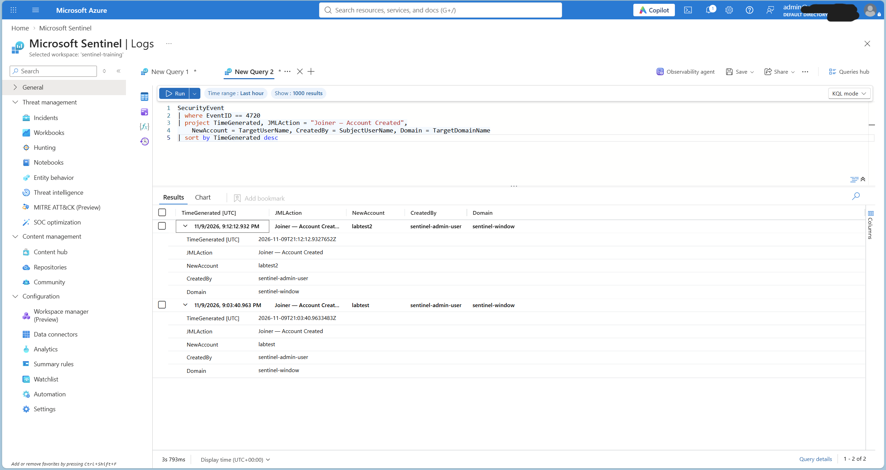
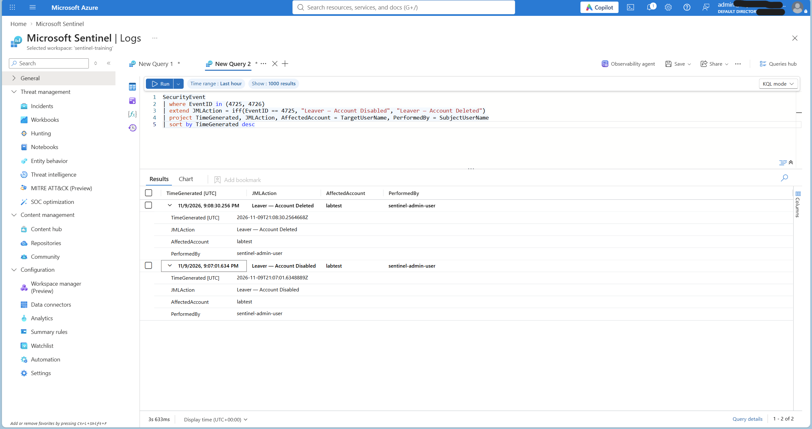
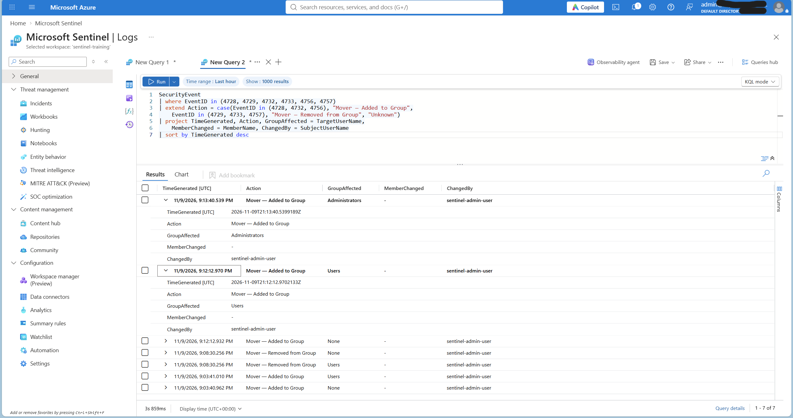
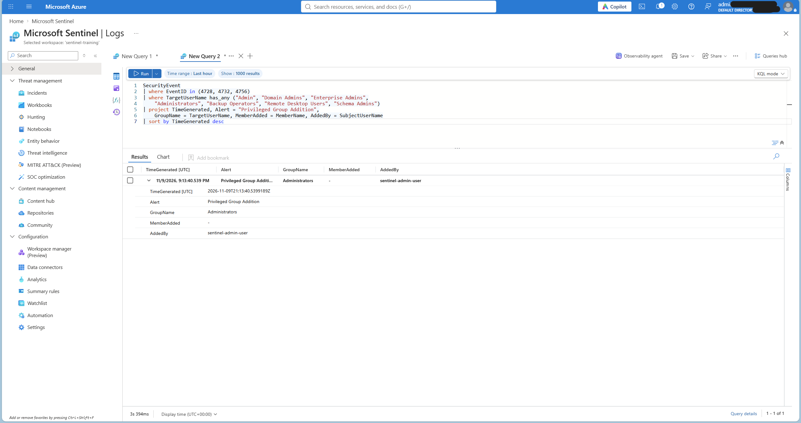
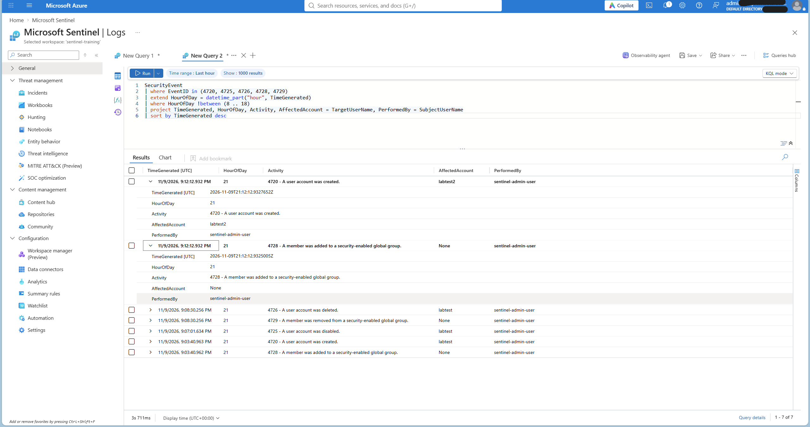

# IAM Lifecycle KQL Lab - Microsoft Sentinel

A hands-on security lab demonstrating Identity and Access Management (IAM) monitoring using KQL (Kusto Query Language) in Microsoft Sentinel. All queries have been executed against a live Azure environment with real event data.

--------------------------------------------------------------------------------------------------------------------------------------------------------------------------------------------

## What is JML?

**JML** stands for **Joiners, Movers, and Leavers** - the three key stages of the identity lifecycle:

|    Stage    |             What it means                |        Security risk if missed              |
|-------------|------------------------------------------|---------------------------------------------|
| **Joiner**  | A new employee joins and gets an account |    Orphaned or unauthorised accounts        |
| **Mover**   | An employee changes role or team         | Excess permissions from old role retained   |
| **Leaver**  |  An employee leaves the organisation     | Active accounts after departure — high risk |

--------------------------------------------------------------------------------------------------------------------------------------------------------------------------------------------

## Lab Environment

|  Component     |                    Detail                            |
|----------------|------------------------------------------------------|
|    SIEM        |               Microsoft Sentinel                     |
|   Workspace    |             `sentinel-training`                      |
| Resource Group |                 `sentinel-lab`                       |
| Windows VM     | `sentinel-windows-vm` (Standard D2s_v7, East US 2)   |
| Connectors     | Windows Security Events via AMA · Microsoft Entra ID |
| Data Sources   | `SecurityEvent` table · `AuditLogs` · `SigninLogs`   |

--------------------------------------------------------------------------------------------------------------------------------------------------------------------------------------------


## Prerequisites

- Microsoft Sentinel workspace
- **Windows Security Events via AMA** connector (for `SecurityEvent` queries)
- **Microsoft Entra ID** connector (for `AuditLogs` / `SigninLogs` queries)
- A Windows VM with a Data Collection Rule (DCR) attached

--------------------------------------------------------------------------------------------------------------------------------------------------------------------------------------------


## Windows Security Event ID Reference

| Event ID |                  Description                 |        JML Stage      |
|----------|----------------------------------------------|-----------------------|
| 4720     |         User account created                 |      Joiner           |
| 4722     |         User account enabled                 |    Joiner             |
| 4725     |        User account disabled                 |    Leaver             |
| 4726     |        User account deleted                  |    Leaver             |
| 4728     | Member added to global security group        |    Mover              |
| 4729     | Member removed from global security group    |    Mover              |
| 4732     | Member added to local security group         |    Mover              |
| 4733     | Member removed from local security group     |    Mover              |
| 4756     | Member added to universal security group     |    Mover              |
| 4757     | Member removed from universal security group |    Mover              |
| 4624     |             Successful logon                 | Threat Investigation  |
| 4625     |             Failed logon                     | Threat Investigation  |
| 4688     |            New process created               | Threat Investigation  |

-------------------------------------------------------------------------------------------------------------------------------------------------------------------------------------------

## IAM - Windows Queries

### Q1 - Joiner: Account Created

**What it does:** Finds every new user account created on the Windows machine (Event ID 4720).

**Why it matters:** Every new account should be expected and authorised. Any unknown account creation is a potential security incident.

```kql
SecurityEvent
| where EventID == 4720
| project TimeGenerated, JMLAction = "Joiner — Account Created",
    NewAccount = TargetUserName, CreatedBy = SubjectUserName, Domain = TargetDomainName
| sort by TimeGenerated desc
```

**What to flag:** Accounts created outside business hours, by unexpected users, or with no corresponding onboarding request.

**Lab result:** Returned 2 rows - `labtest` and `labtest2` both created by `sentinel-admin-user`. ✅



-------------------------------------------------------------------------------------------------------------------------------------------------------------------------------------------

### Q2 - Leaver: Account Disabled / Deleted

**What it does:** Catches accounts being disabled (4725) or deleted (4726), labelling each with the correct Leaver action.

**Why it matters:** When an employee leaves, their account must be disabled immediately. Active leaver accounts are one of the most common causes of data breaches.

```kql
SecurityEvent
| where EventID in (4725, 4726)
| extend JMLAction = iff(EventID == 4725, "Leaver — Account Disabled", "Leaver — Account Deleted")
| project TimeGenerated, JMLAction, AffectedAccount = TargetUserName, PerformedBy = SubjectUserName
| sort by TimeGenerated desc
```

**What to flag:** Accounts still active after an employee's last day, or deletions without a prior disable step.

**Lab result:** Returned 2 rows - `labtest` correctly disabled then deleted by `sentinel-admin-user`. ✅



-------------------------------------------------------------------------------------------------------------------------------------------------------------------------------------------

### Q3 - Mover: Group Membership Changes

**What it does:** Tracks all additions and removals from security groups (Event IDs 4728, 4729, 4732, 4733, 4756, 4757). Uses `case()` to label the direction of change.

**Why it matters:** Movers changing role often need new group access — but old access must be removed. Failure to remove stale permissions causes privilege creep over time.

```kql
SecurityEvent
| where EventID in (4728, 4729, 4732, 4733, 4756, 4757)
| extend Action = case(EventID in (4728, 4732, 4756), "Mover — Added to Group",
    EventID in (4729, 4733, 4757), "Mover — Removed from Group", "Unknown")
| project TimeGenerated, Action, GroupAffected = TargetUserName,
    MemberChanged = MemberName, ChangedBy = SubjectUserName
| sort by TimeGenerated desc
```

**What to flag:** Additions to sensitive groups, or a user added to a group with no corresponding removal from their previous group.

**Lab result:** Returned 7 rows - including additions to `Administrators` and `Users` groups. ✅



-------------------------------------------------------------------------------------------------------------------------------------------------------------------------------------------

### Q4 - Privileged Group Addition Alert

**What it does:** Filters group additions specifically for high-privilege groups like `Administrators`, `Domain Admins`, and `Schema Admins`. Every result here is a potential alert.

**Why it matters:** Addition to a privileged group is one of the highest-risk IAM events. This query is designed to surface those events immediately for review.

```kql
SecurityEvent
| where EventID in (4728, 4732, 4756)
| where TargetUserName has_any ("Admin", "Domain Admins", "Enterprise Admins",
    "Administrators", "Backup Operators", "Remote Desktop Users", "Schema Admins")
| project TimeGenerated, Alert = "Privileged Group Addition",
    GroupName = TargetUserName, MemberAdded = MemberName, AddedBy = SubjectUserName
| sort by TimeGenerated desc
```

**What to flag:** Any addition to a privileged group that wasn't pre-approved via a Change Request or PAM workflow.

**Lab result:** Returned 1 row - `labtest2` added to `Administrators` group by `sentinel-admin-user`. Alert correctly triggered. ✅



-------------------------------------------------------------------------------------------------------------------------------------------------------------------------------------------

### Q5 - Off-Hours IAM Changes

**What it does:** Flags any account creation, disablement, deletion, or group changes that occurred outside business hours (08:00–18:00). Uses `datetime_part()` to extract the hour from each event's timestamp.

**Why it matters:** Legitimate IAM changes almost always happen during business hours. Activity at 2am or on weekends is a strong indicator of either compromise or an insider threat.

```kql
SecurityEvent
| where EventID in (4720, 4725, 4726, 4728, 4729)
| extend HourOfDay = datetime_part("hour", TimeGenerated)
| where HourOfDay !between (8 .. 18)
| project TimeGenerated, HourOfDay, Activity, AffectedAccount = TargetUserName, PerformedBy = SubjectUserName
| sort by TimeGenerated desc
```

**What to flag:** Any result. All IAM changes outside business hours warrant investigation.

**Lab result:** Returned 7 rows - all events occurred at hour 21 (21:00 UTC), correctly flagged as outside business hours. ✅



-------------------------------------------------------------------------------------------------------------------------------------------------------------------------------------------

## Azure AD Queries (AuditLogs / SigninLogs)

### A1 - Joiner: Azure AD User Created

**What it does:** Queries `AuditLogs` for successful "Add user" operations in Azure Active Directory.

**Why it matters:** Cloud identity creation should match your HR onboarding process. Unknown cloud accounts are a huge risk in hybrid environments.

```kql
AuditLogs
| where OperationName == "Add user"
| where Result == "success"
| extend NewUser = tostring(TargetResources[0].userPrincipalName),
    DisplayName = tostring(TargetResources[0].displayName),
    CreatedBy = tostring(InitiatedBy.user.userPrincipalName)
| project TimeGenerated, JMLAction = "Joiner — User Created", NewUser, DisplayName, CreatedBy
| sort by TimeGenerated desc
```

-------------------------------------------------------------------------------------------------------------------------------------------------------------------------------------------

### A2 - Leaver: Azure AD Account Disabled

**What it does:** Finds accounts disabled in Azure AD - the cloud equivalent of a Leaver process.

```kql
AuditLogs
| where OperationName == "Disable account"
| where Result == "success"
| extend AffectedUser = tostring(TargetResources[0].userPrincipalName),
    DisabledBy = tostring(InitiatedBy.user.userPrincipalName)
| project TimeGenerated, JMLAction = "Leaver — Account Disabled", AffectedUser, DisabledBy
| sort by TimeGenerated desc
```

-------------------------------------------------------------------------------------------------------------------------------------------------------------------------------------------

### A3 - Mover: Azure AD Role Assignment

**What it does:** Detects when a user is added to or removed from an Azure AD role - a key signal for privilege escalation or role-based access changes.

```kql
AuditLogs
| where OperationName in ("Add member to role", "Remove member from role")
| extend AffectedUser = tostring(TargetResources[0].userPrincipalName),
    RoleName = tostring(TargetResources[1].displayName),
    ChangedBy = tostring(InitiatedBy.user.userPrincipalName)
| project TimeGenerated, OperationName, AffectedUser, RoleName, ChangedBy
| sort by TimeGenerated desc
```

-------------------------------------------------------------------------------------------------------------------------------------------------------------------------------------------

### A4 - Brute Force Detection

**What it does:** Counts failed sign-in attempts per user and IP address. Surfaces accounts with 5 or more failures - a common indicator of a brute force or password spray attack.

**Why it matters:** A single failed login is normal. Fifty failures from one IP against multiple accounts in an hour is an attack.

```kql
SigninLogs
| where ResultType != 0
| summarize FailedAttempts = count(), UniqueApps = dcount(AppDisplayName),
    SampleApps = make_set(AppDisplayName, 3), ErrorCodes = make_set(ResultType, 3)
    by UserPrincipalName, IPAddress
| where FailedAttempts >= 5
| sort by FailedAttempts desc
```

-------------------------------------------------------------------------------------------------------------------------------------------------------------------------------------------

### A5 - Sign-In Outside Working Hours

**What it does:** Identifies Azure AD sign-ins that occurred outside business hours using `datetime_part()` on the sign-in timestamp.

```kql
SigninLogs
| where ResultType == 0
| extend HourOfDay = datetime_part("hour", TimeGenerated)
| where HourOfDay !between (8 .. 18)
| project TimeGenerated, HourOfDay, UserPrincipalName, AppDisplayName, IPAddress, Location
| sort by TimeGenerated desc
```

---
-------------------------------------------------------------------------------------------------------------------------------------------------------------------------------------------
## KQL Concepts Used

|          Concept             |                Used In                          |
|------------------------------|-------------------------------------------------|
| `where EventID in (...)`     |    Filtering multiple event IDs at once         |
|       `extend`               | Creating new columns from existing data         |
|       `iff()`                |     Single if/else condition (Q2)               |
|      `case()`                |      Multi-branch condition (Q3)                |
|      `has_any()`             |    Matching any value in a list (Q4)            |
| `datetime_part("hour", ...)` | Extracting hour from a timestamp (Q5, A5)       |
|     `!between`               |   Excluding a numeric range (Q5, A5)            |
|    `summarize` + `count()`   |        Aggregating events (A4)                  |
|      `dcount()`              |    Count of distinct values (A4)                |
|      `make_set()`            |    Collect unique values into a list (A4)       |
|       `tostring()`           |   Convert dynamic JSON fields to string (A1–A3) |
|        `project`             |    Select and rename output columns             |
| `sort by TimeGenerated desc` |        Newest events first                      |

-------------------------------------------------------------------------------------------------------------------------------------------------------------------------------------------

## Screenshots

> All screenshots are saved in the [`screenshots/`](screenshots/) folder of this repository.

|        Query        |                                    File                                        |                  Evidence                   |
|---------------------|--------------------------------------------------------------------------------|---------------------------------------------|
| Q1 Joiner           | [`q1-joiner-account-created.png`](screenshots/q1-joiner-account-created.png)   | `labtest` + `labtest2` created — 2 results  |
| Q2 Leaver           | [`q2-leaver-disabled-deleted.png`](screenshots/q2-leaver-disabled-deleted.png) | `labtest` disabled + deleted — 2 results    |
| Q3 Mover            | [`q3-mover-group-changes.png`](screenshots/q3-mover-group-changes.png)         |    7 group membership changes detected      |
| Q4 Privileged Alert | [`q4-privileged-group-alert.png`](screenshots/q4-privileged-group-alert.png)   | `labtest2` → Administrators group — 1 alert |
| Q5 Off-Hours        | [`q5-off-hours-iam-changes.png`](screenshots/q5-off-hours-iam-changes.png)     |    All 7 IAM events flagged at hour 21      |
| Sentinel Setup      | [`sentinel-connector-setup.png`](screenshots/sentinel-connector-setup.png)     | Windows Security Events via AMA — Connected |
| DCR Config          | [`dcr-data-collection-rule.png`](screenshots/dcr-data-collection-rule.png)     |  VM attached to DCR, Common events selected |

-------------------------------------------------------------------------------------------------------------------------------------------------------------------------------------------

## Portfolio / CV Description

> **IAM Lifecycle Monitoring Lab — Microsoft Sentinel (KQL)**
> Built and executed a 10-query KQL lab in Microsoft Sentinel covering the full JML (Joiners, Movers, Leavers) identity lifecycle across both Windows (`SecurityEvent`) and Azure AD (`AuditLogs` / `SigninLogs`) data sources. Deployed a Windows Server VM in Azure, configured the Windows Security Events via AMA connector with a Data Collection Rule, and generated real event data using `net user` and `net localgroup` commands. Queries detect account creation (4720), disablement (4725), deletion (4726), privileged group additions (4732), off-hours IAM activity, brute force patterns, and Azure AD role changes. Demonstrated core KQL skills: filtering, extending, aggregating, and time-based analysis.

-------------------------------------------------------------------------------------------------------------------------------------------------------------------------------------------

## How to Upload Screenshots

1. In your GitHub repo, create a folder called **`screenshots`**
2. Rename each screenshot to match the filenames in the table above exactly
3. Drag and drop them into the `screenshots/` folder on GitHub
4. The images will automatically appear inline in this README

-------------------------------------------------------------------------------------------------------------------------------------------------------------------------------------------

## Skills Demonstrated

`Microsoft Sentinel` · `KQL` · `Azure Monitor` · `Windows Security Events` · `Azure AD / Entra ID` · `IAM` · `JML Lifecycle` · `SOC Analysis` · `Threat Detection` · `Log Analytics` · `Data Collection Rules` · `AMA Connector`
